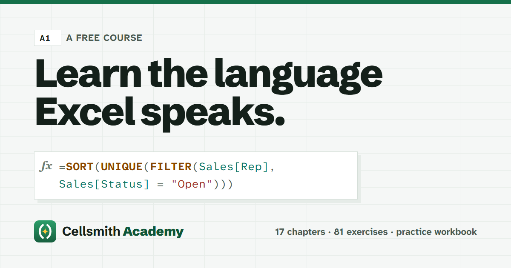

<p align="center"></p>

# Cellsmith Academy

A free course that teaches the Excel formula language, from the first `=SUM` to writing your own `LAMBDA` functions.

**Read it at [itsdaniyalm.github.io/cellsmith-academy](https://itsdaniyalm.github.io/cellsmith-academy/)**

- 17 chapters in four parts, written for people who use Excel every day but never learned formulas properly
- 81 exercises with answers
- A [practice workbook](site/practice/cellsmith-academy-practice.xlsx) with a sheet per chapter that checks your answers as you type
- Every example runs on one small dataset, and **every result shown in the book was calculated by Excel itself** (see [How the book is checked](#how-the-book-is-checked))

## Contents

| | Part A · Foundations | Part B · Core toolkit | Part C · Modern Excel | Part D · Craft |
|---|---|---|---|---|
| 1 | How Excel thinks | Making decisions | Arrays and spilling | Errors and debugging |
| 2 | References | Counting and summing with conditions | FILTER, SORT and UNIQUE | Formulas other people can read |
| 3 | Operators and order | Working with text | Reshaping arrays | Recipe book |
| 4 | Reading and writing functions | Dates and times | Naming things with LET | |
| 5 | | Looking things up | Your own functions with LAMBDA | |

The course assumes Microsoft 365 Excel (or Excel 2024), with US-English function names and comma separators.

## How the book is checked

Formula examples in the chapters are written like this:

````markdown
```formula
=SUMIFS(Sales[Revenue], Sales[Region], "West")
→ 2874.25
```
````

A line starting with `→` is a result. Before publishing, a script types every one of those formulas, and every exercise answer, into a real copy of Excel and compares what Excel calculates with what the book says. The same run builds the practice workbook, and a second script types every answer into the workbook's exercise cells to make sure each self-check turns green.

```bash
npm install
npm run extract                                             # collect examples and exercises from content/
powershell -ExecutionPolicy Bypass -File scripts/workbook.ps1   # calculate them in Excel, build the workbook
npm run check                                               # compare with the book (add -- --fill to fill "→ ?" placeholders)
powershell -ExecutionPolicy Bypass -File scripts/test-workbook.ps1
```

The Excel steps need Windows and Microsoft 365 Excel. Building the site doesn't:

```bash
npm run build    # writes dist/
npm run serve    # http://localhost:4321
```

Pushing to `main` builds the site and publishes it to GitHub Pages.

## Writing conventions

- `→ value` is a checked result; `≈ value` is illustrative and isn't checked (use it for anything that depends on today's date).
- `→ ?` is a placeholder; `npm run check -- --fill` replaces it with Excel's answer.
- Spilled results are written as array constants: `→ {"East"; "North"}`. The site draws them as a grid.
- Exercises use `:::: exercise` with a nested `::: answer`. The first formula in the answer goes into the practice workbook.
- Callouts: `::: tip`, `::: note`, `::: gotcha`.

## Contributing

Spotted a mistake or something unclear? [Open an issue](https://github.com/itsdaniyalm/cellsmith-academy/issues). Corrections to the text are welcome as pull requests; if you change a formula or a result, please run the Excel check, or say in the pull request that you couldn't.

## Related

[Cellsmith](https://github.com/itsdaniyalm/cellsmith) is a free Excel add-in that gives you a proper code editor for formulas: formatting, autocomplete and live error checking. It's a good companion to this course.

## Licence

Course text, exercises and practice data are [CC BY 4.0](LICENSE.md); code is MIT; fonts are SIL OFL 1.1. See [LICENSE.md](LICENSE.md).

Microsoft and Excel are trademarks of the Microsoft group of companies. This course is independent and not affiliated with Microsoft.
